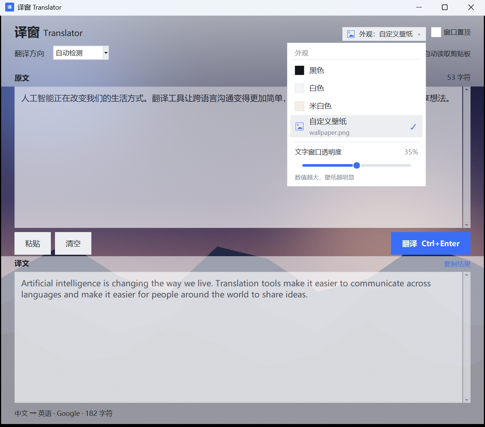
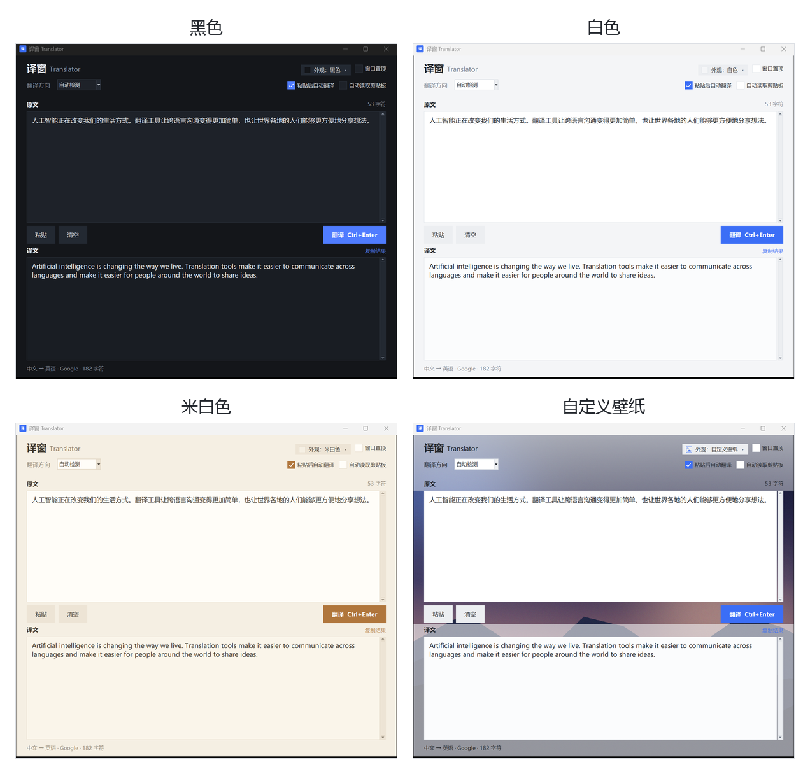

# 译窗 Translator

一个面向 **Windows 10 / 11** 的置顶中英互译小工具。手动粘贴即可翻译，也可以开启自动读取剪贴板；支持四套外观、图片/视频壁纸和原文/译文窗口透明度。

- 仓库：[147-akf/yichuang-translator](https://github.com/147-akf/yichuang-translator)
- 预编译版本：[GitHub Releases](https://github.com/147-akf/yichuang-translator/releases)
- 翻译不需要 API Key，使用公开翻译接口
- 翻译和主题不需要第三方依赖；壁纸功能可选安装 Pillow 和 OpenCV
- 仅支持 Windows 10 / 11



## 项目简介

译窗 Translator 使用 Python + Tkinter 编写，目标是提供一个简单、快速、可以一直放在桌面角落使用的中英翻译窗口。

主要特性：

- **中 ⇄ 英互译**：自动检测语言方向，也可以手动锁定「中文 → 英文」或「英文 → 中文」。
- **窗口置顶**：默认勾选「窗口置顶」，翻译时不会被浏览器等窗口挡住；随时可以取消。
- **四套外观**：黑色、白色、米白色、自定义壁纸，四选一、互斥切换。
- **全窗口壁纸**：图片或视频铺满窗口；顶部/底部有半透明主题色蒙层，文字区域保持清晰。视频静音循环，最高约 15 FPS，窗口最小化时自动暂停。
- **文字窗口透明度**：在外观列表底部调节原文/译文窗口的不透明度，让壁纸从文字区域透出来（0% = 完全不透明）。
- **手动粘贴为主**：默认不监听剪贴板；只有点击「粘贴」或按 `Ctrl+V` 时才读取。
- **可选的自动读取**：开启后，复制文字会自动填入并翻译；默认关闭。
- **粘贴后自动翻译**：默认开启；也可以取消后先编辑，再按 `Ctrl+Enter`。
- **一键复制**：点击「复制结果」或按 `Ctrl+Shift+C`。
- **单实例**：重复启动时会聚焦已打开的窗口，不会产生多个翻译窗口。
- **设置持久化**：窗口位置、外观、壁纸、透明度和开关状态都会保存。

### 界面

主界面右上角的「外观：… ▾」会展开外观列表；列表底部是文字窗口透明度滑块。



## 安装

### 环境要求

- Windows 10 / 11
- Python 3.9 或更高版本
  - 安装 Python 时请勾选 **tcl/tk and IDLE**（Tkinter 是标准库的一部分）

### 获取源码

```bat
git clone https://github.com/147-akf/yichuang-translator.git
cd yichuang-translator
```

也可以在 GitHub 页面下载 ZIP 后解压。

### 下载预编译版本

如果不想安装 Python，可以直接从 Releases 下载 Windows 单文件 exe：

https://github.com/147-akf/yichuang-translator/releases

exe 未做代码签名，首次运行可能被 Windows SmartScreen 提示；可以选择“更多信息 → 仍要运行”。

### 安装依赖

翻译和主题不需要额外安装。使用图片/视频壁纸前，任选一种方式安装可选依赖：

```bat
python -m pip install -r requirements.txt
```

或者双击：

```bat
install_deps.bat
```

两个方式效果相同，安装的是 `requirements.txt` 中的：

- **Pillow**：图片壁纸
- **opencv-python-headless**：视频壁纸

没有安装依赖时程序仍可正常启动，选择壁纸时会提示安装。

## 运行

### 直接运行

在项目目录执行：

```bat
pythonw translator.pyw
```

`pythonw` 不会弹出命令行窗口，适合日常使用。

也可以双击：

- `translator.pyw`
- `run.bat`

调试时可以使用带控制台的 Python：

```bat
python translator.pyw
```

### 创建桌面快捷方式

```bat
python create_shortcut.py
```

脚本会在桌面创建「译窗 Translator」快捷方式，使用项目自带的蓝色图标。

### 打包成 exe

如果希望在没有 Python 的电脑上运行，可以生成单文件 exe：

```bat
build_exe.bat
```

脚本会安装 `requirements.txt` 中的依赖和 PyInstaller，然后生成：

```text
dist\YiChuangTranslator.exe
```

由于包含 OpenCV，exe 体积会比较大，首次启动也会比直接运行源码慢一些。仓库源码中不包含 exe，生成物在 `.gitignore` 中，不会被提交；也可以直接从 [Releases](https://github.com/147-akf/yichuang-translator/releases) 下载预编译版本。

## 配置

### 设置文件

程序设置保存在用户目录：

```text
%USERPROFILE%\.desktop_translator.json
```

也就是：

```text
C:\Users\<用户名>\.desktop_translator.json
```

程序会在设置变化或关闭窗口时自动写入。修改设置前请先关闭程序，避免被运行时状态覆盖。

### 默认配置

```json
{
  "geometry": "",
  "topmost": true,
  "auto_translate": true,
  "watch_clipboard": false,
  "direction": "auto",
  "theme": "light",
  "wallpaper": "",
  "wallpaper_type": "",
  "text_transparency": 0
}
```

### 配置项

| 键 | 类型 | 说明 |
| --- | --- | --- |
| `geometry` | string | 窗口位置和大小，格式如 `929x1078+304+304`；一般由程序自动维护 |
| `topmost` | bool | 是否窗口置顶 |
| `auto_translate` | bool | 粘贴后是否自动翻译 |
| `watch_clipboard` | bool | 是否自动读取剪贴板；默认 `false` |
| `direction` | string | `auto`、`zh-en`（中→英）、`en-zh`（英→中） |
| `theme` | string | `dark`（黑色）、`light`（白色）、`cream`（米白色） |
| `wallpaper` | string | 图片/视频壁纸的绝对路径；空字符串表示纯色主题 |
| `wallpaper_type` | string | `image`、`video` 或空字符串 |
| `text_transparency` | int | 原文/译文窗口透明度，`0`–`70`；`0` 为完全不透明 |

### 外观与壁纸行为

- 四个外观选项是互斥的：选择黑色/白色/米白色会关闭自定义壁纸；选择自定义壁纸会取消主题高亮。
- 自定义壁纸沿用当前主题的配色（蒙层、卡片、按钮颜色）。
- 再次选择列表中的「自定义壁纸」可以更换文件。
- 文字窗口透明度可以在外观列表底部实时调整：数值越大，壁纸越明显；调到 `0` 恢复实色卡片。
- 自动读取剪贴板默认关闭；开启后复制任何文字都会自动填入并翻译，处理密码等敏感内容时请先关闭。

### 重置设置

关闭程序后删除 `%USERPROFILE%\.desktop_translator.json`，再次启动即可恢复默认设置。壁纸文件本身不会被删除。

### 使用其他设置文件（可选）

程序支持通过环境变量 `TRANSLATOR_CONFIG` 指定另一份设置文件，适合测试或便携使用。不设置时使用上面的默认路径。

## 目录结构

```text
DesktopTranslator/
├─ translator.pyw          # 主程序：Tkinter 界面、外观、壁纸、透明度、剪贴板
├─ engine.py               # 翻译引擎：Google 免费接口 + MyMemory 备用、长文本分块
├─ requirements.txt        # 可选壁纸依赖
├─ install_deps.bat        # 安装可选依赖
├─ run.bat                 # 使用 pythonw 启动
├─ build_exe.bat           # 使用 PyInstaller 打包 exe
├─ create_shortcut.py      # 创建桌面快捷方式
├─ icon.ico                # 应用图标（窗口/快捷方式）
├─ icon.png                # README 用图标
├─ screenshot.png          # 主界面截图
├─ screenshots/
│  └─ appearance.png       # 四套外观对比图
├─ README.md
├─ LICENSE
└─ .gitignore
```

`build/`、`dist/`、`*.spec` 和 `__pycache__/` 是运行或打包时生成的目录/文件，已被 `.gitignore` 忽略，不会提交到仓库。

## 常见问题

### 需要 API Key 吗？

不需要。翻译使用 Google 的公开翻译接口，失败时自动切换到 MyMemory。它们适合个人、轻量使用，可能限流或变更；商业或高频使用建议换成官方 API。

### 翻译失败，提示检查网络怎么办？

确认电脑能访问外网；稍后重试。公开接口可能临时超时或限流，程序会自动尝试备用接口。如果两个接口都失败，会显示一次错误提示。

### 壁纸或视频打不开？

先安装可选依赖：

```bat
python -m pip install -r requirements.txt
```

或者双击 `install_deps.bat`。图片支持 PNG/JPG/JPEG/BMP/GIF/WebP/TIFF；视频支持取决于 OpenCV 的解码器，常见 MP4/MKV/MOV/AVI/WMV/WebM 等可用。文件被移动或删除后需要重新选择。

### 视频壁纸卡顿或 CPU 占用高？

视频壁纸会持续解码，建议使用图片壁纸；视频最高约 15 FPS，窗口最小化时会暂停。也可以换分辨率更低的视频。

### 文字窗口透明度没有效果？

该功能使用 Windows 分层窗口，只在 Windows 10/11 上工作。如果系统或窗口组件不支持，状态栏会提示“当前系统不支持文字窗口透明度”。把滑块调回 `0%` 即可恢复完全不透明。

### 设置保存在哪里？怎么恢复默认？

设置文件是 `%USERPROFILE%\.desktop_translator.json`。关闭程序后删除该文件，再启动即可恢复默认设置；不会删除你的壁纸文件。

### 怎么打包 exe？

在项目目录运行：

```bat
build_exe.bat
```

生成的文件是 `dist\YiChuangTranslator.exe`。仓库源码中不包含预编译 exe；可以直接从 [Releases](https://github.com/147-akf/yichuang-translator/releases) 下载，或在本机运行脚本生成。

### 支持哪些系统？

Windows 10 / 11。程序使用了 Windows 的窗口置顶、分层窗口和单实例 API，不支持 Linux / macOS。

### 为什么重复启动没有出现第二个窗口？

程序带有单实例保护。再次启动时会聚焦已经打开的窗口并退出第二个进程。

### 怎么创建桌面快捷方式？

在项目目录运行：

```bat
python create_shortcut.py
```

## 隐私与限制

- 点击「翻译」时，输入框中的文字会通过 HTTPS 发送到 Google 的公开翻译接口；失败时改用 MyMemory。程序不会把原文或译文保存到本地。
- 默认不监听剪贴板；只有手动粘贴时才读取。主动开启「自动读取剪贴板」后，程序会定期检查剪贴板并自动填入翻译；处理敏感内容时请关闭该选项。
- 壁纸图片/视频只在本机读取和显示，不会上传。
- 设置文件只保存窗口位置、外观、壁纸路径和开关状态，不包含翻译内容。
- 公开翻译接口可能限流、变更或无法访问；需要稳定服务时请替换 `engine.py` 中的请求为官方 API。
- 视频壁纸会占用一定的 CPU/GPU 解码资源；文字窗口透明度过高会降低文字与壁纸的对比度。

## 快捷键

| 快捷键 | 作用 |
| --- | --- |
| `Ctrl+V` | 手动粘贴（开启「粘贴后自动翻译」时会立即翻译） |
| `Ctrl+Enter` | 翻译 |
| `Ctrl+Shift+C` | 复制译文 |

## English

**译窗 Translator** is a small always-on-top Chinese ↔ English translator for Windows 10/11.

- Four mutually exclusive appearances: dark, light, cream, and a custom image/video wallpaper.
- Full-window wallpapers with translucent top/bottom bands; videos loop silently at up to ~15 FPS and pause when minimised.
- Adjustable input/output text-window transparency (0–70%).
- Manual paste by default; optional clipboard auto-read and automatic translation after paste.
- Single-instance behaviour; settings persist in `%USERPROFILE%\.desktop_translator.json`.
- Translation and themes need no third-party packages. Wallpapers optionally require Pillow and opencv-python-headless:

  ```bat
  python -m pip install -r requirements.txt
  ```

- Run with `pythonw translator.pyw`, or double-click `run.bat`; build an exe with `build_exe.bat`.
- A prebuilt Windows exe is available on [GitHub Releases](https://github.com/147-akf/yichuang-translator/releases). It is unsigned, so Windows SmartScreen may ask for confirmation on first launch.

Translation text is sent to Google's public endpoint, with MyMemory as a fallback. No text is stored locally. Wallpaper files stay on your computer.

The project is released under the MIT License; see [LICENSE](LICENSE).

## 许可证

本项目采用 [MIT License](LICENSE)。

你可以自由使用、复制、修改、合并、发布、分发、再许可和/或销售本软件的副本，但需要在所有副本或重要部分中保留原始版权声明和本许可声明。

软件按“原样”提供，不附带任何明示或暗示的担保；作者或版权持有人不对因使用本软件产生的任何索赔、损害或其他责任负责。

完整条款见 [LICENSE](LICENSE)。
